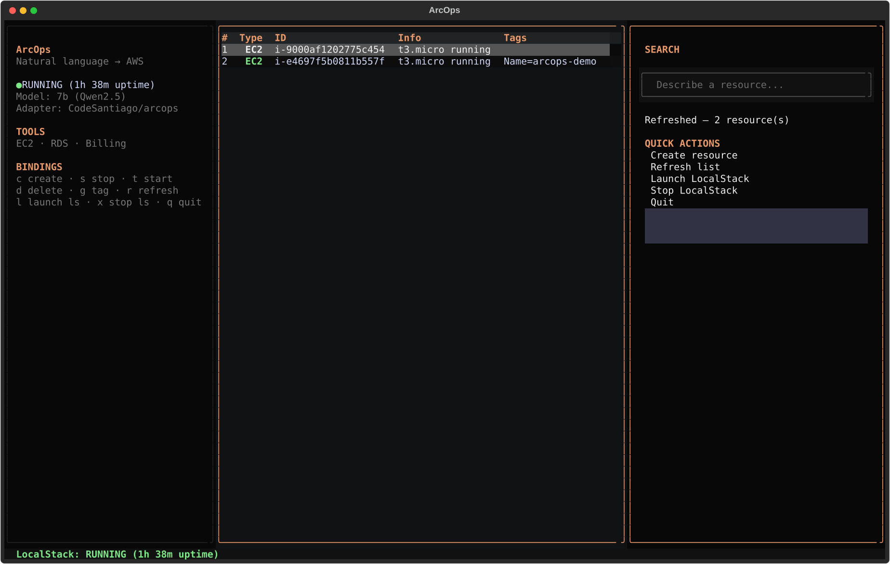

# ArcOps

**Turn plain English into validated AWS actions — locally.**

[](https://github.com/CodeSantiago/ArcOps/actions/workflows/ci.yml)
[](pyproject.toml)
[](LICENSE)
[](docs/ARCHITECTURE.md)

ArcOps is a local-first CloudOps agent. A QLoRA-tuned **Qwen2.5-7B** model turns
natural-language infrastructure requests into JSON tool calls, a deterministic
safety layer validates every call, and an execution layer runs it against
**LocalStack by default**. Real AWS is an explicit opt-in.

```text
User   "Create a t3.micro server in us-east-1 with port 80 open"
  ↓
Model  {"name": "create_ec2_instance", "arguments": {
          "instance_type": "t3.micro", "region": "us-east-1",
          "security_group_rules": [{"port": 80, "protocol": "tcp", "cidr": "0.0.0.0/0"}]}}
  ↓
Safety  JSON Schema ✓ · known EC2 type ✓ · ~$8/mo · no approval needed
  ↓
Execute LocalStack  →  Created i-… (~$8/mo)
```

This is a **v1 reference implementation**, not a hosted product. It exists to
prove a narrow, useful thesis: a small local model can be a reliable tool-call
compiler when the model is surrounded by deterministic validation, a safe
execution path, and an honest evaluation protocol.

<p align="center">
  
</p>

<p align="center"><em>The ArcOps TUI: LocalStack resources, prompt input, model info and safety feedback in one place.</em></p>

---

## Why ArcOps

CloudOps teams spend a surprising amount of time translating routine intent
("open port 80", "restart the primary", "what did we spend this month?") into
CLI commands, API payloads and ticket updates. General-purpose LLMs can write
the prose, but they are not reliable execution engines: they hallucinate
parameters, invent resources, and cannot be trusted with production access.

ArcOps takes the opposite approach:

- **Narrow the problem.** Three high-frequency tools, one JSON schema per tool,
  one canonical engine.
- **Make the model local.** The 7B model runs in 4-bit on a single 12 GB GPU;
  infrastructure context does not leave the machine.
- **Validate deterministically.** A probabilistic model is wrapped in a
  deterministic safety layer: schema, types, known EC2 types, cost, policy and
  approval.
- **Execute safely.** LocalStack is the default. Real AWS requires both an
  environment flag and an interactive confirmation.

The result is less "autonomous agent" and more **compiler for infrastructure
intent**: natural language in, a validated action out.

---

## What makes it different

| Typical LLM agent | ArcOps |
|---|---|
| Returns prose or free-form plans | Returns only a structured tool call |
| Trusts the model's output | Validates against JSON Schema, known types and policy |
| Sends context to a hosted API | Runs inference locally |
| Executes immediately | LocalStack first; real AWS requires explicit opt-in |
| Optimizes for demos | Ships an evaluation protocol and a results policy |

The interesting engineering is not the prompt. It is the **contract around the
model**: one engine, one safety layer, one execution path, five interfaces.

---

## At a glance

| | |
|---|---|
| **Model** | `Qwen/Qwen2.5-7B-Instruct` + QLoRA adapter `CodeSantiago/arcops`, 4-bit |
| **Tools** | `create_ec2_instance`, `restart_database`, `get_billing_alert` |
| **Dataset** | 11,510 raw → **4,285 unique** examples; **64** manual challenge prompts |
| **Dataset audit** | **0 schema-invalid rows** |
| **Tests** | **227 passed, 1 skipped** without ML; **228 passed** with GPU extras |
| **Coverage** | 35% overall, **~58% engine**; schemas 100%, models 98%, safety 64%, core 53%, CLI 47% |
| **Quality gates** | `ruff` clean; `mypy --strict` clean across 7 source files |
| **Quick eval** | 5 built-in cases: tool 5/5, fields 6/11 (54.5%), exact 2/5 (40%) |
| **End-to-end** | EC2 create against LocalStack 3.0 on Windows + RTX 5070 |

The quick eval is a smoke test, not a benchmark. The full protocol is in
[docs/EVALUATION.md](docs/EVALUATION.md).

---

## See it run

**CLI (plan + safety):**

```console
$ arcops "Create a t3.micro server in us-east-1"
=> {"arguments": {"instance_type": "t3.micro", "region": "us-east-1"},
    "name": "create_ec2_instance"}

-- Safety --
Estimated cost: ~$8/mo (t3.micro x1)
```

**TUI (execute against LocalStack):**

```console
$ arcops tui
# press c, type the prompt, Enter
Created i-9000af1202775c454 (~$8/mo)
```

**Machine-readable:**

```console
$ arcops --json "Create a t3.micro server in us-east-1"
{"arguments": {"instance_type": "t3.micro", "region": "us-east-1"},
 "name": "create_ec2_instance"}
```

The CLI, TUI, API, MCP server and `app.exec` all share the same engine
(`cloudops_fc.core`). There is no duplicated inference or AWS logic.

---

## Why now

- **Small local models are good enough for narrow tool use.** A 7B model in
  4-bit fits on a consumer GPU; the hard part is the contract, not the model.
- **Cloud teams want automation without shipping context to a third party.**
  Local inference keeps prompts, resource names and account context on the
  machine.
- **Agent reliability is an engineering problem.** The winning pattern is not a
  bigger prompt; it is schema validation, safe defaults, approval gates and
  measurable evaluation.

---

## Architecture

```text
┌──────────────────────────────────────────────────────────────┐
│ CLI        TUI        API        MCP        app.exec         │
│  arcops    Textual    FastAPI    stdio      plan/execute     │
└──────────────────────────┬───────────────────────────────────┘
                           ▼
                 cloudops_fc.core
        ┌──────────────────┼──────────────────┐
        │                  │                  │
   infer()             safety.check()      execute()
   Qwen2.5-7B           JSON Schema         AWS CLI
   + LoRA, 4-bit        known EC2 types     LocalStack (default)
   greedy decoding      cost + policy       real AWS (opt-in)
```

Design rules:

- **One engine.** Interfaces are thin faces over `cloudops_fc.core`.
- **One safety layer.** `cloudops_fc.safety` is used by every interface.
- **LocalStack first.** Real AWS is never a default.
- **Approval for disruption.** A DB restart requires an explicit confirmation.
- **No hidden defaults.** Missing required parameters are blocked, not filled
  with `test-db` or a random value.

More detail: [docs/ARCHITECTURE.md](docs/ARCHITECTURE.md).

---

## Safety model

| Check | Behavior |
|---|---|
| JSON Schema | Enforces types, patterns, enums and extra keys |
| Required fields | Blocks missing mandatory parameters |
| Unknown tools | Blocks tools outside the registry |
| Known EC2 types | Blocks instance types outside the priced/safety set |
| Cost | Reports an approximate monthly EC2 cost before creation |
| Approval | Disruptive actions (DB restart) require confirmation |
| Policy | Destructive tools (when registered) are blocked in `production` |
| Execution target | LocalStack by default; real AWS requires `ARC_OPS_REAL=1` + confirmation |

EC2 execution creates the requested security group and rules before launching
the instance. LocalStack uses `ARC_OPS_DEFAULT_AMI` (default
`ami-12345678`) when the model omits `ami_id`; real AWS requires an explicit
AMI. The AWS CLI exposes one instance count, so `min_count` maps to `--count`.

---

## Supported tools

| Tool | AWS API | Parameters |
|---|---|---|
| `create_ec2_instance` | EC2 RunInstances | `region`, `instance_type`; optional `ami_id`, `security_group_rules`, `tags`, `key_name`, `subnet_id`, `associate_public_ip`, `min_count`, `max_count` |
| `restart_database` | RDS RebootDBInstance | `db_instance_identifier`, `region`, `force_failover` |
| `get_billing_alert` | Cost Explorer GetCostAndUsage | `time_period_start`, `time_period_end`, `granularity`, `metrics`, `group_by_service` |

`get_billing_alert` is a read-only planning tool. Cost Explorer is unavailable
in LocalStack. `restart_database` requires LocalStack Pro or real AWS; the
community LocalStack 3.0 image implements EC2 but not RDS.

---

## Model and data

- Base model: `Qwen/Qwen2.5-7B-Instruct` (Apache 2.0).
- Fine-tuning: QLoRA with PEFT + TRL; labels masked to the assistant/tool-call
  response.
- Adapter: `CodeSantiago/arcops` (public, 7B only).
- Dataset: deterministic generator (`SEED=42`), 19 template families, 11,510
  raw rows, 4,285 unique after canonical deduplication. Split 80/10/10:
  3,428 train / 429 val / 428 test, with zero train/test overlap.
- Challenge set: 64 manually authored prompts (cities, ambiguity, noise,
  Spanglish, unknown instance types, read-only billing).
- Schema audit: all 11,510 rows validate against the packaged JSON Schemas.

**Results policy.** No checkpoint is shipped. Historical "100%" numbers came
from a split that leaked duplicates and are not trustworthy. The current
pipeline deduplicates before splitting, groups by template family and enforces
a consistency gate. Run `eval.py` against your own adapter; report the mode
next to the score. Details: [docs/EVALUATION.md](docs/EVALUATION.md).

---

## Interfaces

| Interface | Command | Notes |
|---|---|---|
| CLI | `arcops "prompt"` | Tool call + safety feedback |
| CLI (JSON) | `arcops --json "prompt"` | Machine-readable output |
| Quick eval | `arcops --eval` | 5 built-in cases; requires the model |
| TUI | `arcops tui` | Textual dashboard over the same engine |
| API | `python -m app.api` | Localhost FastAPI; optional `X-API-Key` |
| MCP | `uv run --extra train python scripts/mcp_server.py` | `cloudops_plan` and `cloudops_execute` |
| Exec demo | `python -m app.exec "prompt"` | Plan by default; `--live` for LocalStack |

---

## Quick start

### 1. Base install (no GPU, no PyTorch)

```bash
git clone https://github.com/CodeSantiago/ArcOps.git
cd ArcOps
uv sync --extra dev
uv run pytest -q
uv run arcops tools
```

The base install is enough for the schema package, safety layer, CLI metadata
and the full non-GPU test suite.

### 2. Full local stack

Requirements: Python 3.12/3.13, an NVIDIA GPU with ~12 GB VRAM for the 7B
model, Docker for LocalStack, and the AWS CLI for execution.

```bash
uv sync --extra train --extra tui --extra api
```

**Windows / RTX 50-series.** The default PyPI `torch` wheel is CPU-only.
Replace it with the CUDA 13 build:

```powershell
uv pip install --reinstall torch --index-url https://download.pytorch.org/whl/cu130
```

CUDA 12.8+ is required for `sm_120`; the CUDA 13 wheel includes it. Training is
tested on Linux/WSL2.

### 3. Start LocalStack and open the TUI

```bash
docker run -d --name localstack -p 4566:4566 localstack/localstack:3.0
arcops tui
```

In the TUI: `c` to create, type the prompt, Enter. `r` refreshes resources,
`s/t/d/g` stop/start/delete/tag, `q` quits. The TUI uses the same safety and
execution path as the CLI.

### 4. API

```bash
python -m app.api        # 127.0.0.1:8080
curl -s localhost:8080/predict \
  -H "Content-Type: application/json" \
  -d '{"prompt":"Create a t3.micro server in us-east-1","max_tokens":128}'
```

Set `ARC_OPS_API_KEY` to require `X-API-Key`. Schema violations return HTTP 400.

### MCP

Add to your MCP client configuration:

```json
{
  "mcp": {
    "arcops": {
      "command": ["uv", "run", "--extra", "train", "python", "scripts/mcp_server.py"],
      "type": "local"
    }
  }
}
```

The server exposes `cloudops_plan` (inference only) and `cloudops_execute`
(inference + LocalStack execution). MCP execution never targets real AWS and
refuses actions that need interactive approval.

---

## Project structure

```text
ArcOps/
├── src/cloudops_fc/
│   ├── core.py                 # One engine: inference + safety + AWS execution
│   ├── cli.py                  # `arcops` console entry point
│   ├── tui.py                  # Textual dashboard
│   ├── models.py               # ARC_OPS_MODEL / adapter resolution
│   ├── safety.py               # JSON Schema + known types + policies
│   └── schemas/                # Packaged JSON Schemas
├── app/
│   ├── api.py                  # FastAPI server
│   ├── exec.py                 # Plan / LocalStack executor
│   ├── index.html              # Optional web UI
│   ├── tui.py                  # Compatibility shim
│   └── safety.py               # Compatibility shim
├── scripts/
│   ├── generate_dataset_v3.py  # Deterministic dataset generator
│   ├── mcp_server.py           # MCP server
│   └── training/               # train.py, eval.py, splits, configs
├── data/
│   ├── challenge_set.jsonl     # 64 manual prompts (tracked)
│   └── training_dataset.jsonl  # generated locally (gitignored)
├── docs/                       # One-pager, architecture, evaluation, roadmap
├── tests/                      # Non-GPU pytest suite
├── Dockerfile                  # API image: PyTorch 2.14.1 + CUDA 13.0
├── LICENSE                     # Apache 2.0
└── .github/workflows/ci.yml    # Lint + mypy + tests + wheel smoke test
```

---

## Development

```bash
uv sync --extra dev
uv run pytest -q
uv run pytest -q --cov=cloudops_fc --cov-report=term
uv run ruff check src/ cloudops.py app/ tests/ scripts/
uv run mypy src/cloudops_fc
```

CI runs on Python 3.12/3.13 without the ML stack: lint, mypy, module imports,
`app.exec --help`, packaged-schema checks, the full test suite, and a wheel
smoke test. See [CONTRIBUTING.md](CONTRIBUTING.md).

---

## Roadmap

**Near (v1.1)** — full eval report, TUI coverage, approval/audit log, S3 and
Lambda tools, cost guardrails.

**Next (v1.2)** — multi-step plans, dry-run diff, policy engine (OPA),
Terraform/Pulumi adapters, team workspaces.

**Later** — hosted control plane, SSO/RBAC, multi-cloud, plugin SDK and a
distilled 1.5B adapter.

The commercial hypothesis is open-core: the local engine stays Apache 2.0;
team audit, policy packs and a hosted control plane are the paid surface.
Details and success metrics: [docs/ROADMAP.md](docs/ROADMAP.md).

---

## Docs

- [Architecture](docs/ARCHITECTURE.md)
- [Evaluation protocol and results policy](docs/EVALUATION.md)
- [Roadmap](docs/ROADMAP.md)
- [Security policy](SECURITY.md)
- [Contributing](CONTRIBUTING.md)

---

## License

Apache License 2.0 — see [LICENSE](LICENSE).

[Report a bug](https://github.com/CodeSantiago/ArcOps/issues) ·
[Contribute](https://github.com/CodeSantiago/ArcOps/pulls) ·
[HuggingFace adapter](https://huggingface.co/CodeSantiago/arcops)
